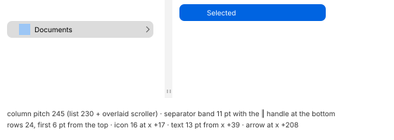

# Column view (MU-22, MU-34)

| Measure | Value |
| --- | --- |
| Column | pitch **245** (a 230 pt list plus an overlaid scroller) |
| Separator | an **11 pt** band on the right side: light `#f3f3f3`, dark `#313132` (backgrounds `#ffffff` / `#272728`) |
| Resize handle | "‖": two 1 pt lines 4 pt apart, 5 pt tall, at the bottom of the band (window y −13…−9, above the horizontal scroll bar) |
| Row | pitch **24**; the first row 6 pt from the top |
| Icon / text | 16 pt icon at x +17, 13 pt text from x +39 |
| Folder arrow | a › chevron 4 × 7 at x +208…+211 |
| Selection | a **208 × 24** rectangle at x +10, radius **~7** |
| Minimum / maximum width | **164** / **no maximum** beyond the available space (2186 was reached in a 2450 pt window, as far as the pointer could go) |
| Preview column | the last column, **240** wide: a 203 × 269 preview at (+10, +10); below it the name in semibold, type and size, Information (Created, Modified), Tags (Add a tag…), and More at the bottom |
| Drag threshold | **1 pt** |

| Selection | Light | Dark | AC light | AC dark |
| --- | --- | --- | --- | --- |
| Active column | `#0064e1` | `#0059d1` | *`#0040dd`* | *`#1874da` (provisional: as the list in AC)* |
| Columns to the left (the path, dark text) | `#dcdcdc` | `#464646` | *`#dcdcdc`* | *`#464646` (provisional: as the list's inactive selection in AC)* |

- **R5.1** Selecting in a column leaves the columns to its left with their selection
  **dimmed** to gray.
- **R5.2** Double-clicking the handle sizes the column to its longest name (477 pt in the test
  folder). With **⌥**, all columns take the same width.
- **R5.3** → opens the next column with its first item selected. ← goes back to the left.
- **R5.4** A new column that does not fit makes the content **jump** to show it whole on the
  right.
  - The jump happens in one frame, with no animation, **~180–200 ms** after the key.
  - The horizontal scroll bar appears.
  - The columns scroll **under** the translucent sidebar.
- **R5.5** A narrow window scrolls the view horizontally; it never squeezes the columns.
- **R5.6** The first column is the sidebar place the browsing started from.
