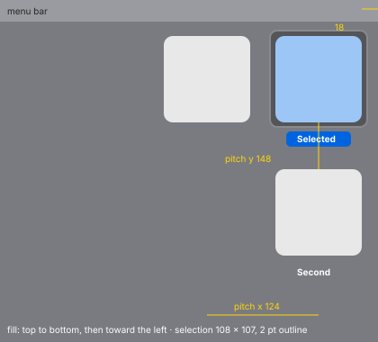

# Desktop icons (MU-90, MU-12)

The desktop is drawn by Silica's shell; these are the file-manager rules it follows.

| Measure | Value |
| --- | --- |
| Measured state | Sort By None, stacks off, **96** pt icons, 12 pt text, labels below |
| First icon | at (2446, 40) on a 2560 pt primary display: its right edge **18 pt** from the screen edge, 40 pt from the top |
| Pitch | vertical **148**, horizontal **124** |
| Labels | **white, bold** (9 pt capital height, *≈ 12 pt provisional*), centered ~10 pt below the icon, with a soft dark shadow (~1 pt down, blur ~2–3 pt; darkest pixel `#535357` over `#7a7b80`); the same in light and dark |
| Selection | a rounded square **108 × 107** (6 pt around) `#545559` (black ~30 %) with a light **2 pt** outline `#88898c`; the same in light and dark |
| Selected name capsule | **17** tall, `#0064e1` / `#0059d1`, white text |
| Selection radius | *~8 pt (provisional: scaled from 6 at 64 in the icon view)* |

| Animation | Delay | Duration |
| --- | --- | --- |
| Use Stacks (⌃⌘0): icons fly into their stacks | +55 ms | **~160 ms** |
| A stack opens in place | +145 ms | **~150 ms** |

- **R15.1** New icons fill the grid **top to bottom** (8 rows on a 1440 pt display), then
  **toward the left**. The icons sit under the windows.
- **R15.2** With stacks on, items group by type (documents, images, …). A type with a single
  item stays a single icon. A closed stack shows **2–3 overlapping, rotated thumbnails** and no
  count.
- **R15.3** Clicking a stack opens it in place:
  - the stack becomes an icon with a ⌄ chevron;
  - its items take the grid cells beside it, moving the others;
  - another click closes it.
- **R15.4** A newly mounted volume takes the **first free grid cell**, after the files already
  there. Volumes get no precedence: with three files in the first column, a never-seen volume
  lands in the fourth cell.
  - A volume seen before returns to its remembered position.
  - Which volumes appear is set in Settings › General.
- **R15.5** Return renames in place, as in the windows (R8.1).
- **R15.6** A volume's desktop icon is a 96 pt external-disk icon. Its label is styled like the
  files' (white, bold, with a shadow).
- **R15.7** A file dragged out of an open stack and dropped on free desktop **stays in the
  stack**.
  - The image returns to its cell in **~250 ms**, decelerating, like a rejected drop.
  - With stacks on, the desktop is always kept in order.
  - Turning stacks off puts the icons back in their previous positions.
- **R15.8** An open stack takes the cells below it and moves the other items.
- Drag threshold: **4–5 pt** (R7.7). The image in flight over the desktop (96 pt icon + pill)
  and dropping onto the desktop: R9.13 in [operations.md](operations.md).
