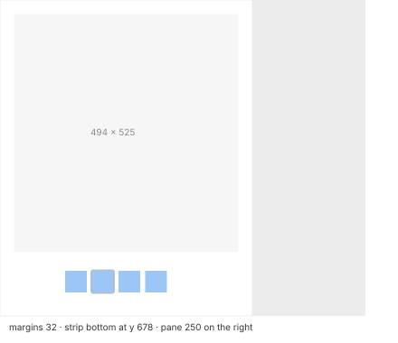

# Gallery (MU-23, MU-24)

| Measure | Value |
| --- | --- |
| Layout | a 558 pt content area plus a **250 pt pane on the right**, always present in the gallery (the width is kept per view) |
| Large preview | a **494 × 525** box, **32 pt** from the left, from the top and from the pane; the content is fitted and centered |
| Preview outline | **1 pt** `#f2f2f2` / `#313132`, **no shadow** |
| Thumbnail strip | its bottom edge at y 678 of the window, above the 19 pt horizontal scroll bar |
| Thumbnails small / medium (default) / large | **32** at a 41 pitch (strip 36) / **48** at 59 (strip 54) / **64** at 77 (strip 72) |
| With file names shown | 48 pt thumbnails at a 95 pitch, strip 88, the name below on 2 lines |
| Selected thumbnail | a rounded square **54 × 54** (3 pt around), `#bdbdbd` / `#5c5c5d` |
| Background | `#ffffff` / `#272728` |
| Pane | a 50 pt icon, the name in semibold, "Type - size", then as the preview pane ([preview-pane.md](preview-pane.md)) |

| Animation | Delay | Duration |
| --- | --- | --- |
| ← → move the selection in the strip | +26 ms | — |
| Large preview follows | +64…+95 ms | one frame, **no transition** |

- **R6.1** When the selection changes, the strip scrolls just enough to keep it visible.
- **R6.2** A PDF shows its first page large; a folder shows its large icon; an item without a
  preview shows the large generic icon.
- **R6.3** The view options (⌘J) are:
  - always open in the gallery, or browse in the gallery;
  - sort order;
  - thumbnail size (3 sizes);
  - show the preview column (on by default);
  - show icon previews (on);
  - show file names (off);
  - use as defaults.
- **R6.4** The strip scrolls with the **horizontal** wheel; the vertical wheel does not move it.
  While scrolling, the large preview does not change: it follows the selection. For fluidity,
  see [list-view.md](list-view.md) (large folders).
