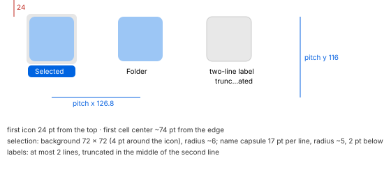

# Icon view

## Grid (MU-21)

Spacing 54, text 12, labels below:

| Icon | Slider value | Pitch x | Pitch y | Columns (content 783) | First icon (x, y) |
| --- | --- | --- | --- | --- | --- |
| 16 | 0 | 129 | 59 | 6 | 69, 21 |
| 32 | 8 | 129 | 78 | 6 | 61, 22 |
| 64 | 24 | **126.8** | **116** | 6 | 42, 24 |
| 96 | 40 | 127.6 | 154 | 6 | 24, 26 |
| 128 | 56 | 186 | 192 | 4 | 48, 28 |
| 512 | 112 | — | 648 | 1, centered | 135, — |

Text size, icons at 64:

| Text | Pitch x | Columns | Pitch y |
| --- | --- | --- | --- |
| 10 | 100 | 8 | 110 |
| 12 | 114 or 128 | 7 or 6 (depending on the scroll bar) | 116 |
| 14 | ~129.6 | 6 | 120 |
| 16 | 153 | 5 | 122 |

The two pitch values at 64/12 (126.8 and 114/128) are consistent: the columns fill the width, as
R4.1 says.

- **R4.1** The x pitch is the available width divided by the number of columns that fit at the
  spacing's minimum pitch. At 64 pt the first cell's center sits ~74 pt from the edge.
- **R4.2** Spacing, at 64 pt:

  | Spacing | Pitch x | Columns | Pitch y |
  | --- | --- | --- | --- |
  | minimum (1) | 87.4 | 9 | 100 |
  | maximum (100) | 189 | 4 | 116 |
- **R4.3** With labels on the right, the pitch is x 190, y 82, and items fill the grid **by
  columns**.
- **R4.4** With "Show item info", each label gets a second line in the accent color (`#146edc`)
  and the y pitch grows by 14 (130). The line shows:
  - the item count, for folders;
  - the size, for files;
  - the duration ("00:04"), for videos.
- **R4.5** A label has at most **2 lines**, at every size, 16 pt included. It wraps even inside
  a word. Past two lines, the second line is truncated **in the middle**.
- **R4.6** At 64 pt the first icon is always 24 pt from the top of the content.
- Tag dots sit **before the name**, on its first line, 5–6 pt before the text (MU-62).

## Selection (MU-21, MU-98)

| Part | Light | Dark | RT light | RT dark | AC light | AC dark |
| --- | --- | --- | --- | --- | --- | --- |
| Icon background (active and inactive) | `#e6e6e6` | `#3c3c3d` | `#e6e6e6` | `#343434` | **`#a6a6a6`** | **`#676768`** |
| Name capsule, active (white text) | `#0064e1` | `#0059d1` | `#0064e1` | `#0059d1` | `#0040dd` | `#1874da` |
| Name capsule, inactive | `#dcdcdc` | `#464646` | — | — | — | — |

| Measure | Value |
| --- | --- |
| Icon background | a rounded square **72 × 72** (4 pt around the 64 pt icon), radius **~6** |
| Name capsule | **17 pt per line** (2 lines: 33), radius ~5, ~4 pt horizontal margin, 2 pt below the icon background; it follows each line's width |
| Icon background at 16/32/96/128 | *4 pt around the icon, radius ~6 (provisional: measured only at 64)* |

## Sorting, free positions, Clean Up (MU-21)

| Animation | Delay | Duration | Shape |
| --- | --- | --- | --- |
| Changing Sort By | next frame (+14 ms) | none | — |
| Clean Up | ~350 ms after the release (~415 after the press) | **~290 ms** | decelerating |

- **R4.7** With Sort By › None, icons have free positions, saved per folder. A dragged icon
  stays where it is dropped.
- **R4.8** Clean Up moves each off-grid icon to the **nearest free cell**. The other icons stay
  still.
- **R4.9** Content scrolling under the toolbar follows R1.9.

How Mustache implements these (commands, storage, shortcuts) is in [product.md](product.md).

## Thumbnails and file icons, all views (MU-80, MU-81)

| Measure | Value |
| --- | --- |
| Thumbnail side | **~89 %** of the icon side. At 128 the maximum is **114** (text 86 × 114, A4 PDF 82 × 114, 4:3 video 114 × 86) |
| Corners | ~3 pt |
| Shadow | soft, ~7 pt per side, shifted down (~7 below, ~5 above). Light: from `#e0e0e0` (sides) / `#cecece` (below) to white. Dark: `#222223` / `#202020` → `#272728`. **No border** |
| Custom folder icon | the image **as it is**, a solid square of the icon's side: no mask, rounding, shadow or frame, in dark too |

- **R4.10** Thumbnails by file type:

  | Type | Thumbnail |
  | --- | --- |
  | Text (`.txt`, `.md`, `.json`) | a white page with the content in small print, **no folded corner** |
  | PDF | the first page with a **folded corner** at the top right |
  | Images and videos | a thumbnail, with no play glyph |
  | Code (`.rs`) | the document icon of the default app |
  | Zip | the generic archive icon with "ZIP" |
  | No extension | a generic document with "?" |
  | Links | the target's thumbnail with an **arrow badge** at the bottom left |
- **R4.11** A newly arrived file appears **already with its thumbnail**, ~270 ms after the copy.
  No placeholder icon was observed.
- **R4.12** Pasting an image on the icon in the Info window changes the icon at once. ⌫ restores
  the folder icon in the next frame (+19 ms), with no animation.
