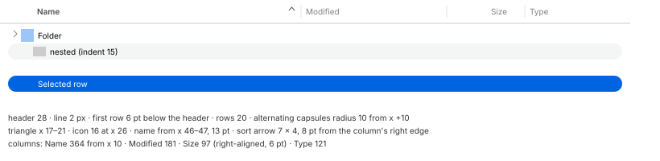

# List view

## Geometry (MU-20, MU-24, MU-25)

| Measure | Value |
| --- | --- |
| Header | **28** tall, under the toolbar (y 52–80) |
| Line under the header | light: 2 px `#e5e5e5`; dark: 1 pt `#494949` + 1 pt `#363637` |
| Column separators | 1 × 16 (y 58–73), light `#e5e5e5`, dark `#535353` |
| Header text | 8 pt capital height (*~11 pt, provisional*); the sorted column's label is semibold |
| Sort arrow | a **7 × 4** chevron (∧ ascending, ∨ descending), its right edge 8 pt from the column's right edge, y 64–67 |
| Row | **20 pt**; the first row starts 6 pt below the header |
| Alternating rows | radius 10 capsules on even rows, from x +10 to 10 pt from the scroller; they continue past the last row and fill an empty folder |
| Disclosure triangle | a 5 × 8 chevron at x 17–21 of the content (target 15 × 22 at x 11) |
| Icon | 16 × 16 at x 26 |
| Name | from x 46–47, **13 pt** regular (capital height 9) |
| Indent per level | **15 pt** |
| Default columns | Name 364 (from x 10), Modified 181, Size 97, Type 121 |
| Alignment | Size right-aligned (6 pt from the edge); Modified and Type left-aligned (+6) |
| Minimum column width | 75 observed for Modified |
| Scroll bar | 11 pt track; minimum thumb **11 × 20** (~19–20) |
| Header, hovered | no change |
| Header, pressed | the whole cell (separator to separator, 28 pt) turns light **`#f2f2f2`**, dark **`#414141`**; the label is unchanged |
| Sorting | happens on release of a short click (~130 ms later). A long press (1 s) then release does not sort |
| Separator pointer zone | 5 pt (3 left of the line, 1 right), full height; no guide line while dragging |
| Row and triangle, pressed | nothing changes until release. The selection shows +19 ms after the release; the triangle opens on release |

Colors:

| Element | Light | Dark | RT light | RT dark | AC light | AC dark |
| --- | --- | --- | --- | --- | --- | --- |
| Content background | `#ffffff` | `#272728` | `#ffffff` | `#1e1e1e` | `#ffffff` | `#272728` |
| Header background | `#ffffff` | `#2f2f2f` | `#ffffff` | — | `#ffffff` | `#2f2f2f` |
| Alternating rows | `#f4f5f5` | `#313132` | `#f4f5f5` | `#292929` | `#ebebeb` | `#3c3c3d` |
| Line under the header | `#e5e5e5` | `#494949` + `#363637` | `#e5e5e5` | `#383838` + `#2e2e2e` | `#595959` | `#8d8d8d` + `#b3b3b4` |
| Header, sorted column | `#4d4d4d` | `#ffffff` | — | — | — | — |
| Header, other columns | `#808080` | `#ababab` | `#808080` | `#9a9a9a` | `#3e3e3e` | `#c0c0c0` |
| Name | `#252525` | `#dfdfe0` | `#252525` | `#dedede` | **`#000000`** | **`#ffffff`** |
| Secondary columns | `#7b7b7b` | `#a2a2a2` | `#7b7b7b` | `#9f9f9f` | **`#393939`** | **`#c4c4c4`** |
| Active selection | `#0064e1` | `#0059d1` | `#0064e1` | `#0059d1` | **`#0040dd`** | **`#1874da`** |
| Line between selected rows (1 pt) | `#2673e4` | `#2469d5` | `#2673e4` | `#2469d5` | `#2050e1` | `#3582de` |
| Name on the active selection | `#ffffff` | `#ffffff` | `#ffffff` | `#ffffff` | *`#ffffff` (provisional)* | *`#ffffff` (provisional)* |
| Secondary on the active selection | `#bdcef5` | `#bbcbf0` | `#bdcef5` | `#bbcbf0` | `#cfd5f7` | `#c1d3f3` |
| Inactive selection | `#dcdcdc` (line `#d1d1d1`) | `#464646` (line `#424242`) | `#dcdcdc` | `#464646` | `#dcdcdc` | `#464646` |
| Name / secondary on the inactive selection | `#222222` / `#6e6e6e` | `#e3e3e3` / `#acacac` | — | — | — | — |
| Scroll bar: track / thumb | `#f3f3f3` / `#7a7a7a` | `#313132` / `#a2a2a2` (border `#969696`) | — | — | — | — |

Text colors were measured twice, 2–5 levels apart (text antialiasing). The table uses the
recording made together with the variants.

## Formats

- **R3.1** Dates (Mustache's English formats):
  - today: "Today, 10:22";
  - yesterday: "Yesterday, 18:05";
  - otherwise: abbreviated month, day, year (always shown) and time.
- **R3.2** Sizes use decimal units (1 KB = 1000 bytes):

  | Size | Format |
  | --- | --- |
  | Under 1000 bytes | "N bytes" |
  | KB and MB | **whole numbers** (2967 bytes → "3 KB") |
  | GB | **two decimals** ("2.15 GB") |
  | Folders | "--" |
  | Empty files | "Zero bytes" |
- **R3.3** The type is one short name per family: folder, link, text, archive, video, PDF, image
  plus its format, audio plus its format, and document for anything unknown.
- **R3.4** Names that do not fit are **truncated in the middle**; so are values in the Type
  column. Tag dots sit at the end of the Name column.

## Sorting and columns

- **R3.5** Clicking a new header sorts Name **ascending**, and Modified and Size **descending**.
  A second click reverses the order.
  - Name order is alphabetical and case-insensitive.
  - Folders mix with files unless "Keep folders on top" is set (MU-97).
- **R3.6** Columns can be rearranged and resized:
  - dragging a header reorders the columns;
  - dragging an edge resizes the column on its left, and the last column absorbs the
    difference;
  - widening Name pushes the other columns out to the right, and the view scrolls
    horizontally.

## Nesting

| Animation | Delay | Duration | Shape |
| --- | --- | --- | --- |
| Triangle | 0 | one frame, no animated rotation | — |
| Open: the children come out from under the parent, the rows after them move down | ~+100 ms | **~200 ms** | *soft end (provisional: as the other openings)* |
| Close | +74 ms | ~190 ms | the same |

- **R3.7** ⌥-click on the triangle opens or closes **the whole subtree**. → and ⌘→ open, ← and
  ⌘← close.

## Selection

- **R3.8** Contiguous selected rows form **one block**: rounded outer corners (radius ~8–9),
  square inner ones, and a 1 pt line between rows. A lone selected row is a 20 pt capsule. Both
  use the same insets as the alternating rows (x +10).
- **R3.9** Right-clicking an unselected item leaves the selection alone and draws a **2 pt
  ring** in the accent color (`#0064e1` / `#0059d1`) inside that row's capsule (MU-50).
- **R3.10** An empty folder, or a search with no results, shows the header and the alternating
  rows and **no text** (MU-70).

## Large folders, all views (MU-24)

Measured with 10 000 files:

| Measure | Value |
| --- | --- |
| Opening by double click, never opened before, list | **+445 / +481 ms** from the first press (≈ 330–360 from the second click) |
| Folder with 1 file | +284 ms |
| Loading indicator | **none**: the previous folder stays on screen until the first complete draw |
| View change (⌘1…⌘4) | icons +144, columns +156, list +188, gallery +207 ms |
| Scrolling at 48 000 pt/s: median frame interval | list 26.7, icons 26.7, columns 13.3 ms (max 40–53) |
| Scrolling the gallery strip (horizontal wheel, ~10 000 pt/s, dark) | 143 frames, median **13.3 ms**, 47 over 20 ms, **max 27 ms** (single dropped frames) |

Mustache's target: *opening ≤ 450 ms and 13.3 ms frames in list and icons too (provisional: the
best case observed, in columns)*.
