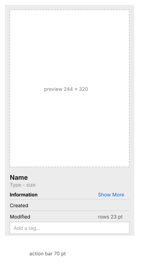

# Preview pane, ⇧⌘P (MU-05)

| Measure | Value |
| --- | --- |
| Position | right of the content area. Its divider is a 1 pt target with **no visible line**: only the background changes |
| Width | initially **264** (250 in the gallery: it is kept per view); **min 240**, **max 480** |
| Closing by dragging | dragging the divider to ~120 pt from the right edge (about half the minimum) closes it |
| Material | translucent: the list continues under it and its selection shows through, blurred |
| Preview | a **244 × 320** box with a 10 pt margin; the content is fitted and centered |
| Name | semibold, *~15 pt (provisional)*, at y +356; under it, in gray, the type and the size |
| Information | a bold heading plus a Show More link in the accent color; **23 pt** rows (label left, value right) separated by 1 pt lines |
| Tags | an Add a tag… field, 244 × 33 |
| Action bar | **70** tall, solid background, buttons with an icon and a label (e.g. 74 × 56) |

| Color | Light | Dark |
| --- | --- | --- |
| Background | `#ececec` (`#e8e9ea` at the top) | `#2a2a2b` |
| Action bar | `#ffffff` | `#272728` |
| Tag field | `#ffffff` | `#272728` |
| Lines between details | `#d5d5d5` | `#474748` |

What it shows, by selection:

| Selection | Preview | Details | Actions |
| --- | --- | --- | --- |
| Image | thumbnail | Created, Modified, Dimensions; Show More adds the content creation date, color space and profile | Rotate Left, Edit, More |
| PDF | first page | Created, Modified (long format) | Edit, More |
| Folder | large icon | Created, Modified | More |
| Video | a frame | plus Dimensions and Duration ("00:04") | Rotate Left, Trim, More |
| Text | the content as a page, scrollable | Created, Modified | More |
| Several items | a fan of rotated thumbnails, "N items", "N documents - X KB" | dates as a range | Create PDF, More |

| Animation | Delay | Duration | Shape |
| --- | --- | --- | --- |
| Opening: slides in from the right while the content narrows | +124 ms (first change) | +177 → ~+340 (~165 ms) | decelerating |
| Closing: slides out to the right | +29 ms | to ~+255 (~225 ms) | accelerating |

- **R1.23** A reopened pane takes the last width used in that view.
- **R1.24** Resizing the window keeps the pane's width; the content area absorbs the change.
- **R1.25** In the column view, the pane replaces the preview column.
