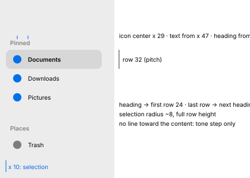

# Sidebar

Mustache's sections are Pinned (user folders and added items), Places (home, disks, volumes,
network, Trash) and Tags.

## Geometry and text (MU-10, window measurements)

| Measure | Value |
| --- | --- |
| Extent | top to bottom of the window, attached to its edges (its left corners are the window's), no margin or radius of its own |
| Default width | **192** (one early measurement on a test window gave 200) |
| Rows | **32** pt pitch |
| Heading → first row / last row → next heading | 24 / 40 pt |
| Icons | box 16–19 × 14–17, left edge at ~20–22 (center x ≈ 29), vertically centered |
| Tag dots | **13 × 13**, solid, center x 29 |
| Text | from x **47**, regular; *~14 pt (provisional: from the 10 pt capital height, in Inter)* |
| Section headings | from x 17, semibold/medium; *~11–12 pt (provisional: 9 pt ascenders)* |
| Scroller | 5 pt at x 284–288 in a 192 pt sidebar, plus a 3 pt strip of a different tone on the right |
| Edge toward the content | no line: only a change of tone |

Colors, active window unless said otherwise:

| Element | Light | Dark | RT light | RT dark | AC light | AC dark |
| --- | --- | --- | --- | --- | --- | --- |
| Background, active | `#ececed` | `#2a2a2c` | `#f7f7f7` | `#141414` | `#f0f0f1` | `#262628` |
| Background, inactive | `#f2f2f2` | `#29292a` | `#f4f4f4` | `#101010` | `#f4f4f4` | `#353536` |
| Text | `#000000` | `#ffffff` | `#000000` | `#ffffff` | `#000000` | `#ffffff` |
| Text, inactive window | `#727272` | `#969696` | `#747474` | `#888888` | `#727272` | `#9d9d9d` |
| Headings, active / inactive | `#808182` / `#a6a6a6` | `#7c7d7e` / `#5c5c5d` | — | — | — | — |
| Blue icon | `#0070eb` | `#00abff` | `#0072ee` | `#00a1ff` | **`#003ac2`** | `#47baff` |
| Gray icon (home, Trash) | `#7c7c82` at rest, `#6e6e74` under the selection | `#b6b7bd` at rest, `#c7c7cd` under the selection | — | — | — | — |
| Icons and dots, inactive window | `#7f7f7f` | `#929293` | — | — | — | — |
| Scroller, active / inactive | `#a5a6a7` / `#ababab` | `#5c5d5f` / `#5c5c5d` | — | — | — | — |

The active background is a material: it depends on what lies behind the window. Sessions
measured `#e5e5e7`–`#ededed` in light and `#29292a`–`#303133` in dark; over nothing it is
`#eaeaea` / `#272728`. The table uses the values recorded together with the variants.

## Selection, hover, focus (MU-10)

| Measure | Value |
| --- | --- |
| Shape | rounded rectangle, **radius ~8**, **32** tall (the whole row), from x **10** to ~x 171 (200 pt sidebar with scroller) |
| Selected text | **semibold** (regular at rest); the icon keeps its color |
| Hover | **no background**, no change |

| Selection | Light | Dark | RT light | RT dark | AC light | AC dark |
| --- | --- | --- | --- | --- | --- | --- |
| Background, active | `#d7d7d7` | `#464647` | `#e0e0e0` | `#333333` | **`#a1a1a1`** | **`#646465`** |
| Sidebar background in the same recording | `#ededed` | `#29292a` | `#f7f7f7` | `#141414` | `#f1f1f1` | `#242425` |
| Text, active | `#000000` | `#ffffff` | `#000000` | `#ffffff` | `#000000` | `#ffffff` |
| Background, inactive window | `#e7e7e7` on `#f3f3f3` | `#373738` on `#29292a` | — | — | — | — |
| Text, inactive window | `#676767` | `#9b9b9c` | — | — | — | — |
| Selected red tag dot | `#f20015` | `#ff6769` | — | — | — | — |

The selection behaves like black at ~10 % over the background in light and white at ~13 % in
dark (*provisional: derived from two measurements, so that it follows the material*).

- **R2.1** Clicking a row selects it and the window shows that place. Keyboard focus stays where
  it was, in the content view.
  - Tab, ⇧Tab and ⌃Tab never move the focus into the sidebar, with keyboard navigation on or
    off.
  - The sidebar therefore has **no "selected with focus" state**. See R1.30 for the control
    cycle.

## Hide and show, ⌃⌘S (MU-10)

Progress of the content's left edge while hiding:

| t (ms) | 21 | 61 | 75 | 88 | 115 | 128 | 141 | 168 | 181 | 195 | 221 | 235 | 261 |
| --- | --- | --- | --- | --- | --- | --- | --- | --- | --- | --- | --- | --- | --- |
| progress | 0.02 | 0.08 | 0.13 | 0.20 | 0.36 | 0.44 | 0.54 | 0.79 | 0.85 | 0.91 | 0.98 | 1.00 | 1 |

| Animation | Delay | Duration | Shape |
| --- | --- | --- | --- |
| Hide: the sidebar slides left, the content widens | ~0 | **~240 ms** (half at ~140) | S curve |
| Show | ~40 ms | **~230 ms** (0.05 at +53, 0.36 at +120, 0.71 at +173, 0.95 at +226, 1 at +280) | S curve |

- **R2.2** While the sidebar hides, the icon grid reflows early, at ~75 ms, not at the end.

## Sections and headings (MU-11)

| Measure | Value |
| --- | --- |
| Chevron on hover over a heading | a ∨ **10 × 6** on the right (an 18 × 21 target), shown in the same frame as the pointer arrives: **0 ms**, no fade |
| Chevron position | 31 pt from the right edge with the scroller; ~17 pt further right without |

| Animation | Delay | Duration | Shape |
| --- | --- | --- | --- |
| Collapse (6 rows, 192 pt) | +70 ms | ~190 ms (still at +255) | soft end: 0.20 / 0.39 / 0.63 / 0.84 / 0.93 / 0.99 at +81 / +108 / +148 / +188 / +215 / +241 |
| Expand | +120 ms | ~190 ms (still at +308) | the same (0.21 / 0.40 / 0.65 / 0.84 / 0.94 / 0.99) |

- **R2.3** Clicking the chevron turns it into › at once, with no rotation, and the section
  collapses.
  - The disappearing rows lose their text right away; their icons remain.
  - The rows slide up, clipped by the heading.
  - The sections below rise with them.

## Dragging, adding, removing (MU-11, MU-40)

| Measure | Light | Dark |
| --- | --- | --- |
| Insertion line (dragging from the content into Pinned) | **2 pt** `#015ad8`, with a hollow circle on the left (8 pt outer, 2 pt stroke) | `#0059d1` |
| Line extent | from 14 pt from the sidebar's left edge to 29 pt from its right edge, on the boundary between rows | same |
| Drag start threshold | **5 pt** (no drag up to 4) | |

| Animation | Duration | Shape |
| --- | --- | --- |
| Reordering inside: a one-row gap opens, rows slide by 32 pt | ~160 ms | soft end |
| Removing by dragging out: the rows below move up | one frame (~50 ms after the release) | none |
| Removing by dragging out: the dragged ghost (icon + name) | **one frame (≤ 14 ms)**, **no puff** or animation | none |

- **R2.4** Dragging a folder from the content between two Pinned rows shows the insertion line.
  The rows do **not** move. The item appears on release.
- **R2.5** Dragging an item inside the sidebar shows **no line**. A gap opens, and the item
  follows the pointer as a semi-transparent ghost (icon + name).
- **R2.6** An item dropped outside the sidebar is removed from it, and the folder itself is
  untouched. This also holds when it is dropped on the desktop. There is **no puff**: the ghost
  vanishes in one frame.
- **R2.7** Add to Sidebar (⌃⌘T) puts the item at the bottom of Pinned. A folder with a custom
  icon shows there with the **generic folder symbol** (MU-81).
- **R2.8** Dragging a file over a row highlights the row in the accent color with white text.

## Width (MU-11)

| Measure | Value |
| --- | --- |
| Minimum | **135 pt** |
| Maximum | window width − **316** (the content never goes below 316) |
| Snap | released between **191 and 209** → **200** |
| Pointer on the edge | a horizontal double arrow, also at the minimum |

- **R2.9** Dragging below 135 keeps the sidebar at 135 while the pointer is more than ~65 pt
  from the window's left edge (the threshold is between 60 and 70). Further left, the sidebar
  **hides**, as with ⌃⌘S.
- **R2.10** A width change applies to that window. New windows take the last width set.

## Volumes and Trash (MU-12, MU-50)

| Measure | Light | Dark |
| --- | --- | --- |
| Eject button | **always visible**; a 14 × 11 target 151 pt from the left edge (27 from the right); glyph 10 × 9 | |
| Eject glyph | `#adadad` | `#6a6a6b` |
| Eject glyph, button hovered | `#6e6e6e` | `#a5a5a6` |
| Row hovered | no background | no background |

- **R2.11** A newly mounted volume appears in Places ~320 ms later. It goes right after the user
  folder, appears **in one frame**, and the rows below drop by 32 pt at once.
- **R2.12** Clicking eject removes the row ~300 ms later, in one frame, with no progress shown.
  A window that was showing the volume moves elsewhere; where to was not observed.
- **R2.13** If the volume is busy, an alert opens, **292 × 226**, horizontally centered **on the
  screen** at y 305.
  - It has a 66 pt icon (a warning triangle with the app badge) and a single sentence.
  - It has **two stacked full-width buttons**, 262 × 30, 4 pt apart:
    - the primary one, "Eject When Done", is `#007aff` in light and dark;
    - "OK" is `#dedede` / `#808080`.
- **R2.14** The Trash's context menu in the sidebar has **no** Empty Trash item.
  - In the sidebar the Trash icon is **the same empty and full** (an outline glyph).
  - In the Dock, an empty Trash is a transparent bin, and a full one shows colored sheets.
  - The Trash window is described in [operations.md](operations.md).
- **R2.18** While a volume is dragged, the Trash in the Dock turns into an eject symbol
  **from the start of the drag**, not on hover. Its hover label stays "Trash".
  - Dropping the volume on it ejects the volume, and the Trash returns to normal ~450 ms after
    the release.
  - A disk image ejects at once, with no progress.

## Tags (MU-62)

- **R2.15** Clicking a tag shows the items with that tag, in the **icon view**.
  - The title is the tag's name.
  - The path bar is empty.
  - The status bar shows only the item count, with no free space.
- **R2.16** A tag without a color shows a gray **ring** `#6e6e74` instead of a dot.
- **R2.17** A new tag appears **at the top** of the Tags section.
- **R2.19** Renaming a tag in Settings › Tags (R10.7) updates the name **at once in every open
  window's sidebar**.
- Dot colors at rest:

  | Color | Light | Dark |
  | --- | --- | --- |
  | Red | `#fb001a` | `#ff5e5f` |
  | Orange | `#f87b00` | `#ffbf0c` |
  | Yellow | `#f2b400` | `#fff600` |

  The dark values are oversaturated by the color conversion and only indicative. Green, blue,
  purple and gray at rest have no converted measurement yet. See also
  [open-questions.md](open-questions.md).

