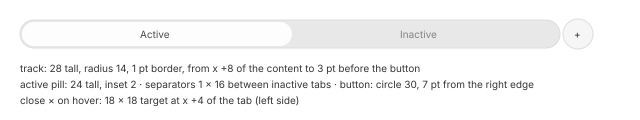

# Tabs (MU-01)

| Measure | Value |
| --- | --- |
| When it shows | with two or more tabs, **under the toolbar**, above the content area only (not above the sidebar) |
| Bar | 28 pt tall at y 52; the content moves down by **36 pt** (y 52 → 88) |
| Track | a capsule **28** tall, 1 pt border, radius 14, from x +8 of the content area to 3 pt before the new-tab button |
| Active tab | a pill **24** tall, inset **2 pt** (1 border + 1), fully rounded |
| Separators between inactive tabs | 1 × 16 pt, centered; hidden next to the active tab and next to the hovered one |
| New-tab button | a **30 pt** circle, 3 pt after the track and 7 pt from the right edge; plus glyph 11 pt, stroke ~1.5 |
| Close on hover | on the **left**: an 18 × 18 target at x +4 of the tab, × glyph ~8 pt. On the active tab only the × appears |
| Title | 8 pt capital height (*~11 pt, provisional*), centered, truncated **at the end** |
| Minimum width | **120 pt**; past that, tabs on the left shrink to 4–5 pt, stacked |

| Color | Light | Dark |
| --- | --- | --- |
| Track | `#e8e8e8` | `#404041` |
| Track border | `#dcdcdc` | `#4f4f50` |
| Active tab | `#fefdfe` | `#464648` |
| Inactive tab, hovered | `#dcdcdc` | `#4b4b4b` |
| Separator | `#cccccc` | `#575758` |
| New-tab button (top → bottom) | `#fbfbfb` → `#f6f6f6`; hovered `#f3f3f3` → `#ececec` | `#474748` |
| New-tab glyph | `#282828` | `#dadada` |
| Title active / inactive | `#4c4b4c` / `#828282` | `#ececec` / `#8b8b8c` |
| × glyph | ~`#7b7b7b` | ~`#909091` |

Measured widths on a ~752 pt track:

| Tabs | Widths |
| --- | --- |
| 2 | 389, 358 |
| 3 | 265, 249, 232 |
| 4 | 194, 194, 179, 178 |
| 6 | 124 × 5, 123 |
| 7 | 50, 92, 120 × 5 |
| 8 | 17, 32, 92, 120 × 5 |

With few tabs the widths differ by up to 33 pt and no rule explaining it was found. *Mustache
uses equal widths (provisional).*

| Animation | Delay | Duration | Shape |
| --- | --- | --- | --- |
| New tab enters from the right edge, the others squeeze | +314 ms (loading) | 90 % at ~+470, still at ~+690 (~375 ms visible) | exponential, **τ ≈ 75 ms** (the distance halves every ~53 ms) |
| Close: the pill moves to the neighbor, the closed tab shrinks | ≤ +139 ms | within 1 pt at ~+486, still at ~+593 | the same exponential |
| Reorder: the pill settles after the release | — | ~250 ms | *soft end (provisional: as opening)* |
| All Tabs, enter | +161 ms | ~190 ms (still at ~+350) | — |
| All Tabs, exit (Esc) | +46 ms | ~230 ms (still at ~+273) | the inverse |

- **R1.10** A tab dragged out of the window becomes a window thumbnail, ~186 × 128 (scale
  ~0.19). On release, a window of the same size appears with the pointer at (500, 78),
  horizontally centered. The source window turns inactive and closes the gap.
- **R1.11** A tab dropped on another window's bar becomes its last tab, and active. While
  dragged it is a pill with a shadow.
- **R1.12** Dragging a tab along the bar swaps it with a neighbor once the pointer passes the
  neighbor's middle; the others slide. Widths stay **by position**.
- **R1.13** With a single tab there is no bar. The Show Tab Bar command (⇧⌘T) exists; its effect
  with a single tab was not tried.
- **R1.14** ⌘ + double click on a folder, with "Open folders in tabs" on, opens it in a new
  active tab.
- **R1.15** During a file drag, holding the pointer over an inactive tab activates it after
  **~1060 ms** (MU-40).

## All Tabs (⇧⌘\\)

| Measure | Value |
| --- | --- |
| Background (sidebar and toolbar disappear, window buttons stay) | light `#dddddf`, dark `#3a3b3d` |
| Box | **280 × 193** (21 pt header + 172 pt thumbnail), x pitch **305**, the first at (55, 76) |
| Active tab | **3 pt** outline, `#0070f5` light / `#007aff` dark, radius ~10 |
| Close in the box | × 11 pt at x +10 of the header; title centered |
| New-tab box | `#c4c4c6` / `#5e5f61`, glyph `#464648` / `#d9dadc`, stroke ~2 |

- **R1.16** Entering All Tabs shrinks the active tab from the full window to its thumbnail (with
  its outline already shown), and the others come in from the left. Esc does the reverse.
