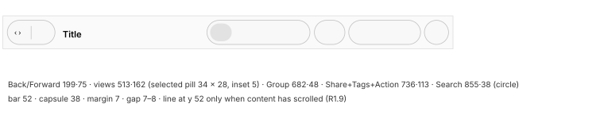

# Toolbar

## Geometry (MU-02, window measurements)

| Measure | Value |
| --- | --- |
| Height | **52 pt** from the top, starting at the sidebar's right edge |
| Background, active window | none: the content color |
| Background, inactive window | light = content; dark `#2f2f30`–`#2e2e2e`. A 1 pt line at y 52, light `#e5e5e5`, dark `#363636` (with content scrolled under the bar, R1.9 applies: see open-questions, item 18) |
| Capsules | **38** tall, 7 pt margin above and below, radius 19 (full). Search is a 38 pt circle |
| Space between capsules | 7–8 pt |
| Capsules in a 900 pt window (x · width) | Back/Forward 199 · 75; views 513 · 162; Group 682 · 48; Share + Edit Tags + Action 736 · 113; Search 855 · 38 |
| Back/Forward separator | 1 × 21 pt (y 16–36), light `#c7c7c7`, dark `#7a7a7a` |
| Selected view in the group | pill **34 × 28**, inset 5 pt, radius 14; light `#e2e2e2` (→ `#e7e7e7` at the bottom), dark `#595959` |
| Glyph boxes | Back 8 × 14, Forward 8 × 13, icons 15 × 15, list 17 × 12, columns 20 × 15, gallery 19 × 15, Group 18 × 18 + chevron 7 × 4, Share 14 × 18, tag 17 × 17, Action three 3 × 3 dots at a 6 pt pitch, Search 16 × 16; stroke ~1.5 |
| Glyph color | light `#000000`, dark ~`#e9e9e9`; disabled light `#ababab` |
| Title | from x 286 in a 1000 pt window, center y 30, semibold; *size ~15 pt (provisional: from the 10.75 pt capital height, in Inter)* |
| Title color | active light `#4d4d4d`, dark `#e9e9e9`; inactive `#bebebe` / `#646464` |
| Title minimum width | **160 pt** (from the moment the overflow menu appears); it truncates inside those 160 |
| Bar with Icon and Text labels | **66 pt** (+14); a label under each item, *~10 pt (provisional, from the letter height)* |
| Focus ring on a control (keyboard navigation on) | **4 pt**, inset 1 pt in the control's box, following the segment shape; **`#89aff7`** light, **`#3d7aa6`** dark |

- **R1.30** With system keyboard navigation on, **⌃Tab** and **⌃⇧Tab** cycle through the
  controls: content view → scroll bar → Back → view group → Group → Action → Search → back to
  the view. The sidebar is not part of the cycle. Tab and ⇧Tab stay inside the view (R7.2)
  (MU-10).

## Control states (MU-07)

Colors at the center of the pill, outside the glyph.

| State | Light active | Dark active | Light inactive | Dark inactive |
| --- | --- | --- | --- | --- |
| Rest: capsule / glyph | `#f8f8f8` / `#000000` | `#434344` / `#ffffff` | `#f0f0f0` / `#a4a4a4` | `#424243` / `#757576` |
| Pointer over: pill | `#eeeeee` | `#5e5e5f` | `#e6e6e6` (glyph `#000000`) | `#565657` (glyph `#ffffff`) |
| Pressed: pill / glyph | `#e8e8e8` / `#232323` | `#737374` / `#f8f8f8` | as active (the click activates the window) | `#6d6d6e` |
| Selected segment: rest / over / pressed | `#e5e5e5` / `#dbdbdb` / `#d2d2d2` | `#575758` / `#727273` / `#757576` | `#dcdcdc` / `#d2d2d2` / — | `#565657` / `#6a6a6b` / — |
| Disabled: over / pressed | no pill / ≤ 6 levels | no pill / a faint pill (`#444445` → `#626264`) | none | none |
| Dark, pointer anywhere in the bar | — | bar background `#272828` → `#2e3030`, capsules +7 levels (`#4a4a4b`) | — | — |

| Measure | Value |
| --- | --- |
| Hover pill | **28** tall, 5 pt inside the 38 pt capsule, as wide as the segment minus ~3 pt (Back 33, icons 35, list 38, columns 41, gallery 36, Share 30, tag 33, Action 30). A button with its own capsule gets the capsule minus 2 pt (Group 47 × 34, Search 36 × 34) |
| Separators next to the hovered segment | hidden |
| Press | the pill darkens (light −16 levels, dark +48) and the whole capsule grows **1 pt per side** (scale ~1.01–1.02) |
| History menu (long press on Back/Forward) | 186 × 58; its left edge on the segment, its top 2 pt above the capsule's bottom; 24 pt items with a 16 pt icon, 5 pt margin |

| Animation | Delay | Duration |
| --- | --- | --- |
| Hover pill in and out | — | one frame, no fade |
| Pressed state | first frame | one frame |
| Back: navigation | ~96 ms after the release | — |
| View group: view change | ~100 ms after the release; the selected pill jumps, no sliding | one frame |
| History menu | **~295 ms** after the press, while held | one frame |

- **R1.31** Holding Back or Forward for ~0.3 s opens the history menu. Releasing over the button
  closes the menu without navigating. A short click navigates on release.
- **R1.32** In an inactive window, the pointer over a control lights it up (pill and full-color
  glyph). The click activates the window and performs the action.
- **R1.33** Group, Action, the overflow button and the views menu open their menu on press.
  Share and Edit Tags open their popover on release. Search opens its field on release.

## Capsules in the appearance variants (MU-98)

Background top → bottom; outline top / bottom / sides.

| Part | Light | Dark | RT light | RT dark | AC light | AC dark |
| --- | --- | --- | --- | --- | --- | --- |
| Background | `#f6f6f6`→`#fdfdfd` | `#4c4c4c`→`#535454` | `#ffffff` flat | `#141414`→`#1d1d1d` | `#f8f8f9`→`#fefefe` | `#202020`→`#2a2a2a` |
| Outline | `#ebebeb` / `#e8e7e8` / `#c1c1c1` | `#79797b` / `#6c6e6e` / `#131313` | `#ececec` / `#e8e8e8` / `#c3c3c3` | `#3d3d3d` / `#3d3d3d` / `#070707` | `#ebebeb` / `#e8e8e8` / `#c3c3c3` | `#4a494a` / `#484848` / `#0c0c0c` |

An earlier measurement gave close values for the plain variant (background `#f7f7f7`–`#fcfcfc`,
dark `#454546`–`#484849`; sides `#c1c1c1` / `#0f0f0f`). Use this table: all its columns come
from the same recording.

## Title icon and path menu (MU-02)

| Animation | Delay | Duration | Shape |
| --- | --- | --- | --- |
| A 16 pt folder icon appears left of the title; the title slides **20 pt** right | **~300 ms** after the pointer reaches the title | **~210 ms** | decelerating |
| Pointer leaves | next frame | **~250 ms**, the icon fades | *soft end (provisional: the inverse of the entry)* |

- **R1.5** ⌘-click or right-click on the title opens the **path menu**. The current folder is at
  the top with a check mark, then its parents up to the disk and the computer. The menu is
  199 pt wide, with 24 pt items and 16 pt icons. The current item sits over the title, centered
  on it, and the menu's left edge is 14 pt left of the title icon.
- **R1.6** Dragging the title icon carries only the 16 pt semi-transparent icon under the
  pointer; the window is not highlighted.

## Compression as the window narrows (MU-02)

Sidebar at 192; the content-area width is in parentheses.

| Window width | Effect |
| --- | --- |
| ≥ 893 (≥ 701) | everything visible |
| 889 (697) | the view group becomes a **48 × 38** pop-up (icon + up/down chevrons) |
| 712–717 (520–525) | Edit Tags and Action move into the **overflow** menu, a 38 pt glass circle before Search |
| 677–681 (485–489) | Share too |
| 629–633 (437–441) | Group too |
| 574–577 (382–385) | the views pop-up too |
| 524–529 (332–337) | Back/Forward disappear; the title moves to x 196 |
| 508 (minimum) | title, overflow, Search |

- **R1.7** As the content area drops below each threshold, the items leave in the order above,
  right to left. Search always stays. The items that leave go into the overflow menu.
- **R1.8** The overflow menu opens **to the right** of its button. It has text-only items in
  the bar's order, with unavailable ones disabled; 139 pt wide, 24 pt items.

## Content under the bar (MU-99)

- **R1.9** Content that scrolls under the toolbar stays visible, blurred, behind a **uniform**
  veil.
  - The veil covers **y 1 to y 51**, with no vertical gradient. Row y 0 is 1 px lighter: 148 over
    black in light, 53 in dark.
  - The veil is the same in active and inactive windows.
  - The capsules show the colors under them, refracted at their edges (MU-21).

  An earlier session saw a ~83 % white veil with a gradient over the last 7 pt and no line: see
  open-questions, item 17.

The veil formula has an error ≤ 0.7 levels over 5 colors. L is the Rec. 709 luminance of the
content, and the result is clipped to 255:
`out = offset + scale · (L + s · (in − L))`

| | offset | scale | saturation s | Equivalent | Examples |
| --- | --- | --- | --- | --- | --- |
| Light | **135.3** | **0.486** | **1.24** | white at ~51 % + saturation ×1.24 | black → `#888888`, red `#f13710` → `#ff9e86`, blue → `#8585ff` |
| Dark | **31.1** | **0.400** | **1.25** | `#333333` at ~60 % + saturation ×1.25 | white → `#858585`, black → `#1f1f20`, red → `#8f311e` |

| Measure | Value |
| --- | --- |
| Blur | **two Gaussians of about equal weight**: σ **3–4 pt** + σ **34–36 pt**. Light: weights 0.46 / 0.54, σ 4.2 / 36.1. Dark: 0.52 / 0.48, σ 3.2 / 33.7 (rms deviation 1.4–1.8 %). A single Gaussian (σ 15–18) triples the error. Vertically: a steep step over ~6 pt with long tails |
| Line at the bottom edge (y 52) | **none** while the content is at the top. A 1 pt line across the content width **as soon as it scrolls**: light ×0.9 (white → `#e5e5e5`), dark +7 % white (black → `#121212`) |
| List view | the veil continues under the **column header** (one band, y 0–79); the line `#e5e5e5` sits under the header (y 80) |
| With the tab bar | separator at the top of the tab bar (y 53, `#e7e7e8`); the veiled band = toolbar + tabs + header; line `#e5e5e5` at y 116 |

Mustache builds this band with silica_ui's `ScrollUnderToolbar` (mustache#3).

## Customization (MU-06)

| Measure | Value |
| --- | --- |
| Sheet | **1066 × 500**, hanging from the bottom of the bar (y 52), centered on the window (it may overflow it); translucent material, dark 1 pt border, shadow also above |
| Palette | items **100 × 68** (38 pt icon + two-line label), 8 per row, row pitch 78; items already in the bar are dimmed |
| Default set strip | 1002 × 67 on a rounded background |
| Bottom controls | a Show pop-up 129 × 26 (Icon and Text / Icon Only / Text Only) and a Done button 74 × 26 in the accent color |
| Available items, in order | Back/Forward, Path, Group, View, Action, Eject, Burn, Space, Flexible Space, New Folder, Delete, Connect, Get Info, Search, Quick Look, Share, Edit Tags, Preview, nearby sharing, cloud storage |
| Default bar | Back/Forward, View, Space, Group, Space, Share, Edit Tags, Action, Space, Search |

| Animation | Delay | Duration |
| --- | --- | --- |
| Sheet appears | ~910 ms after the click on the menu item | ~95 ms |
| Closing with Done | — | 1–2 frames (~150 ms from the press) |
| Gap opening when an item enters the bar | — | ~130 ms |

- **R1.26** An item dropped between two neighbors joins **their capsule** (the groups merge) and
  dims in the palette. While dragged, it is a circle with a shadow.
- **R1.27** A bar item dropped on the palette disappears in one frame, with no visible puff.
- **R1.28** With Icon and Text, each item gets a **separate** capsule or circle and the View group
  becomes a 48 × 38 menu. The choice applies to **all** windows. With Text Only the bar stays
  52 pt and shows text only.
- **R1.29** Every bar item has accessibility actions to move it to the previous or next position
  and to remove it, also outside the sheet. Every palette item has actions to insert it at the
  start or at the end.
