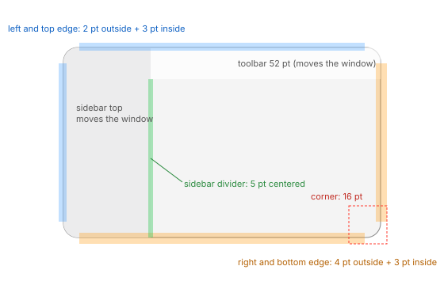

# Window

## Shape, background, shadow (MU-01, window measurements)

| Measure | Value |
| --- | --- |
| Minimum size (sidebar shown, icon view) | **508 × 252** |
| Corners | a continuous curve, not a circular arc: it starts **24 pt** from the corner and cuts 16 pt off the first row. Pixels missing per row 0…23: 16.00, 10.05, 7.90, 6.42, 5.26, 4.28, 3.47, 2.73, 2.14, 1.73, 1.37, 0.95, 0.85, 0.72, 0.59, 0.47, 0.37, 0.30, 0.23, 0.18, 0.14, 0.10, 0.06, 0.03 |
| Corner approximation | superellipse r 33.5, n 4.5 (r and n are correlated); the equivalent circular radius, 17.6, is only an order of magnitude |
| Body | fully opaque |
| Content background | light `#ffffff`, dark `#272728` |
| Inner 1 pt border | light: none. Dark active `#3d3d3d` on all sides. Dark inactive `#404041` on top, `#3a3a3b` on the left |
| Contact ring (1 pt, black) | alpha: active light 0.32, active dark 0.95; inactive light 0.23, inactive dark 0.87 |
| Increase Contrast | no extra border visible at 1× |

The shadow is black, Gaussian, with alpha(d) = A · ½ · erfc((d − s) / (√2 σ)), d being the
distance from the window edge:

| | Active light | Active dark | Inactive light | Inactive dark |
| --- | --- | --- | --- | --- |
| A / s / σ | 100 / 0.5 / 19.5 | 190 / −1 / 20 | 72 / −2 / 8.5 | 194 / −4 / 9 |
| Vertical offset | 18 | 18 | 7 | 7 |
| Extent side / above / below | 56 / 38 / 74 | 56 / 38 / 74 | 23 / 16 / 30 | 23 / 16 / 30 |

## Window buttons

Diameter **14 pt**, centers at x 26, 49, 72 (pitch 23) and y 26, the middle of the 52 pt bar.
Ossido draws them; colors per state are in silica-desktop's window spec.

- **Hover:** the symbols appear on all three buttons within 70–110 ms of entering.
- **Leaving:** the symbols go away 60–130 ms after the pointer leaves.

## Animations

| Animation | Duration | Shape |
| --- | --- | --- |
| Open (new window) | ~100 ms | scale 0.98 → 1.00 around the center, already opaque, decelerating |
| Close | ~100–120 ms | fade, opacity 0.76 → 0 over 5 frames, scale change ≲ 0.5 % |
| Minimize to the Dock / restore | ~390 / ~440–470 ms | the "genie" deformation, fast start and slow tail |
| Full screen enter / exit | ~520 / ~453 ms | enter accelerates then decelerates; exit decelerates |

## Rules

- **R1.1** When a window opened with New Window is closed, its frame (position and size) becomes
  the saved frame. A window opened by a script does not update it (MU-01).
- **R1.2** A new window takes the saved frame and the last sidebar width (MU-01, MU-11). If a
  window of the same series already sits there, the new one shifts by **+29, +29 pt** from the
  previous one. It does not cascade away from windows of other apps.
- **R1.3** Quitting and reopening the app restores no window. New Window opens on the active
  screen at the same relative position (MU-01).
- **R1.4** New windows show the folder chosen in Settings › General; the default is Recents
  (MU-00, MU-97).

## Drag zones and edges (MU-08)

| Measure | Value |
| --- | --- |
| Zones that move the window | the toolbar's empty area (between and below the capsules), the top of the sidebar (below and beside the window buttons), the tab track left of the first tab, the status bar |
| Zones that do not | the title (text and its field, x 485–810 in the test window), the empty part of the path bar, the column header right of the last column, the preview pane, the tab track between the last tab and the new-tab button |
| Move threshold | **~4 pt**. From the status bar there is no measurable threshold |
| Double click on the toolbar or the top of the sidebar | **Zoom**: the frame fits the content, top-left corner fixed (1000 × 728 → 1082 × 372 with the preview pane, 830 × 372 without) |
| Double click elsewhere (title, tabs, status bar, path bar, header, preview) | nothing |
| Left and top resize edge | **2 pt outside + 3 pt inside** the edge |
| Right and bottom resize edge | **4 pt outside + 3 pt inside**, also below the sidebar and below the content |
| Corners | diagonal resize for **16 pt** along each edge from the corner; diagonally, from ~10 pt inside to 1–2 pt outside |
| Sidebar / content divider | a 5 pt zone centered on the divider |

- **R1.34** Dragging from the toolbar's empty area, the top of the sidebar, the tab track or the
  status bar moves the window after ~4 pt. Dragging from the title, the path bar, the column
  header or the preview does not.
- **R1.35** Double-clicking the toolbar's empty area or the top of the sidebar zooms the window
  to fit its content. A double click in the other zones does nothing.

